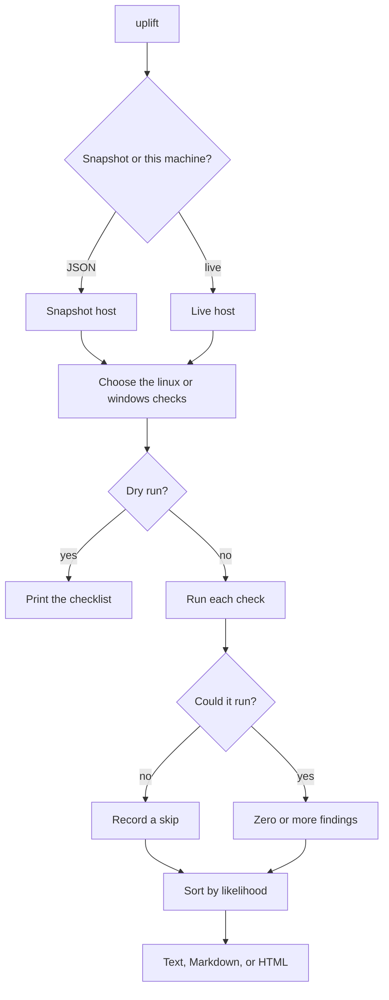

# uplift

[](https://github.com/WastedPatriot/uplift/actions/workflows/ci.yml)
[](https://www.python.org/)
[](LICENSE)

You already have a shell. The interesting question is whether the host has left a door propped open with a fire extinguisher.

uplift reads a Linux or Windows machine, or a JSON snapshot of one, and writes down local configuration that weakens a privilege boundary: setuid bits, file capabilities, cron, sudo, `PATH`, service paths, token privileges, `AlwaysInstallElevated`. Each note gets a likelihood from 0 to 10, meaning how directly that configuration matters. The report is text, Markdown, or one HTML file with the CSS baked in.

It does not pop shells, fetch exploits, or phone home. If the lift goes up, the building was wired that way.

## Authorised use

Run it on hosts you are allowed to assess. A lab, a CTF box, the image your tutor handed you, your own kit. It records misconfigurations and their impact. It does not exploit them, and it will not make an unauthorised look any more authorised.

## Quick start

```sh
python3 -m venv .venv
. .venv/bin/activate
pip install -e ".[dev]"

uplift --snapshot examples/lab-linux.json
uplift --snapshot examples/lab-windows.json --format both -o report
```

From a checkout, without installing:

```sh
./scripts/uplift --dry-run
./scripts/uplift --snapshot examples/lab-linux.json
```

`--dry-run` prints the checklist and writes nothing. `-o report` writes `uplift.md` and `uplift.html`. The HTML file does not need a network.

Exit status is `0` when nothing reaches `--fail-on` (default `high`), `2` when something does, and `1` when the arguments or the snapshot are no good. A dry run is always `0`.

## Sample run

This is `examples/lab-linux.json`, a small pretend lab image. The clock in a real run will differ. The hash and the preload path in that file are fake, and they stay out of the report.

```text
$ uplift --snapshot examples/lab-linux.json
Host        lab-linux
User        student (uid 1000)
OS          linux (checked linux)
Kernel      4.15.0-20-generic
Findings    9 interesting, 2 info, 0 skipped
```

The lines above are the header with the sermon removed. The findings underneath are verbatim.

<details>
<summary>Three findings from that run</summary>

```text
Extra account with uid 0
severity    critical
likelihood  9/10 (very high)
check       sensitive_files
  account toor
  uid 0
Account 'toor' has uid 0 as well as root. That account is another superuser, whatever its name is.
Fix: Remove the extra uid 0 account, or give it a normal uid if it must keep the name.

File capability can cross a privilege boundary
severity    critical
likelihood  9/10 (very high)
check       capabilities
  /usr/bin/python3.11
  cap_setuid
/usr/bin/python3.11 carries file capabilities: cap_setuid (can change the process user id). A capability on a program applies when that program runs, including for this account.
Fix: Remove capabilities the program does not need, and prefer the distribution package.

Cron job runs a writable program
severity    high
likelihood  8/10 (high)
check       cron
  /etc/cron.d/backup
  /opt/scripts/backup.sh
A cron entry in /etc/cron.d/backup runs /opt/scripts/backup.sh, and this account can change that program. The scheduled command would pick up the change.
Fix: Point the job at a root-owned absolute path, and remove write access to that program.
```

</details>

A tidy host gets a shorter conversation. `examples` does not include one; `tests/fixtures/linux_quiet.json` does. Baseline setuid files such as `sudo` and `passwd` are noted as info and then ignored for the "anything interesting?" question.

## Usage

```text
uplift [--os auto|linux|windows] [--dry-run]
       [--format text|md|html|both] [-o DIR]
       [--snapshot FILE] [--fail-on none|info|low|medium|high|critical]
```

`--os auto` follows the host, or the snapshot's `os` field. Asking for Windows checks on a Linux machine does not invent a registry; the checks say they were skipped.

Live `sudo -l` is not run. It would sit there waiting for a password, which is a poor way to spend a lift ride. If you already have the output, put it in the snapshot as `sudo_l`. If `/etc/sudoers` is readable, that is used instead.

<details>
<summary>Flags</summary>

| Flag | What it does |
| --- | --- |
| `--os` | `auto` (default), `linux`, or `windows` |
| `--dry-run` | List the checks. Do not run them, do not write a report |
| `--format` | `text` (default), `md`, `html`, or `both` |
| `-o, --output` | Directory for `uplift.txt`, `uplift.md`, or `uplift.html` |
| `--snapshot` | JSON host, so you do not need root and the tests do not either |
| `--fail-on` | Lowest severity that produces exit code 2. Default `high` |
| `--version` | Print the version and leave |

`both` needs `--output`, because Markdown and HTML on one stdout is how arguments are born.

</details>

<details>
<summary>Snapshot shape</summary>

A snapshot is a JSON object: `os`, `user` (`name`, `uid`, optional `gids` and `groups`), optional `env`, `kernel`, `sudo_l`, `getcap`, `files`, and on Windows `registry`, `services`, and `privileges`.

File modes are octal strings (`"4755"`). Missing data is a skip, not a crash and not a pretend clean bill of health. See `examples/lab-linux.json` and `examples/lab-windows.json`. The same idea, smaller, lives in `tests/fixtures/` for the unit tests.

Password material is not copied into the report. A shadow hash, a Winlogon `DefaultPassword`, or the body of an unattend file is detected and then left out.

</details>

## What gets checked

Linux: setuid and setgid files against a short baseline, file capabilities, sensitive paths (`passwd`, `shadow`, `sudoers`, `ld.so.preload`), cron files and the programs they name, sudoers or `sudo_l`, `PATH`, and whether the kernel series is older than 5.10. The kernel note is an age check. There is no exploit list.

Windows: `AlwaysInstallElevated` in both hives, unquoted service paths, service binaries marked writable, sensitive token privileges, Winlogon auto-logon, leftover unattend files, and `PATH`.

On a real Windows host the registry and service list come from the local registry. Privileges come from `whoami /priv`. Anywhere else those checks skip, politely.

## How it works



Likelihood is a triage hint. A 9 means the configuration itself crosses a privilege boundary, as with another uid 0 account or a writable service binary. A 3 means "this kernel series is old, go and read the vendor tracker". It is not a claim that a particular exploit applies, because uplift does not carry any.

<details>
<summary>Roadmap</summary>

- A baseline file, so a lab image can silence setuid paths the tutor has already signed.
- Diff two snapshots and show what changed after someone "fixed" it.
- systemd units themselves, not only the mode of the directory they live in.
- macOS, if anyone asks twice.
- SARIF, for the three people who will ask.

Not on the list: exploit modules, payload generation, or a network scanner. Wrong tool, wrong floor.

</details>

<details>
<summary>Hold music</summary>

`--elevator-music` and `--up` do the same small thing. They announce the floors on stderr and leave the findings alone.

If the car is empty, the report says so. It is allowed to sound slightly pleased.

</details>

## Tests

```sh
pip install -e ".[dev]"
ruff check .
pytest
```

The tests build fake filesystems and fake registries. They do not need root, and they check that secrets planted in fixtures do not leak into the report.

## Licence

[MIT](LICENSE). Copyright 2026 WastedPatriot. Problems in the tool itself, as opposed to findings about a host, go through [SECURITY.md](SECURITY.md).
